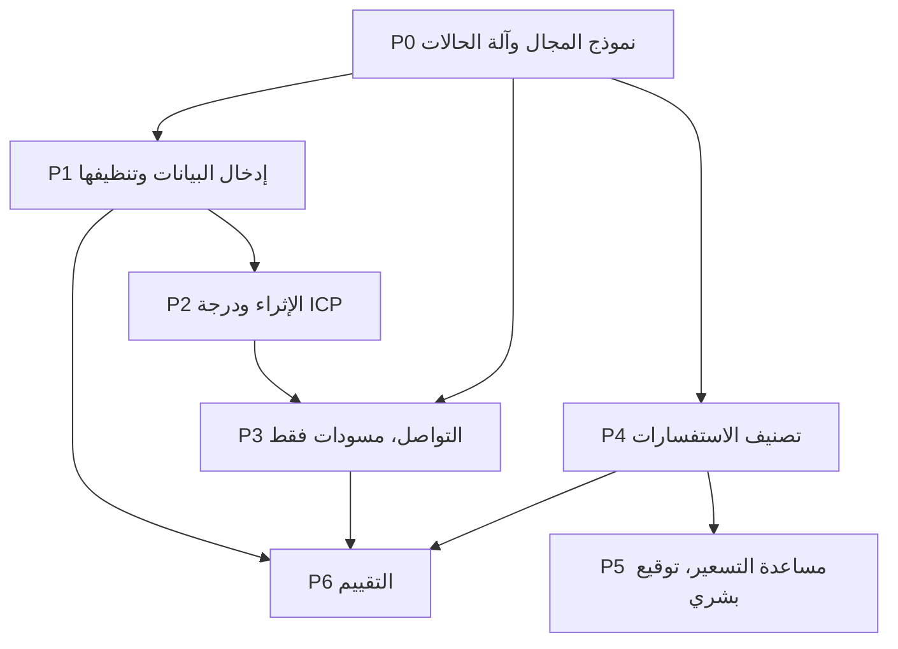

[简体中文](README.md) | [繁體中文](README.zh-Hant.md) | [English](README.en.md) | [Deutsch](README.de.md) | [Français](README.fr.md) | [Español](README.es.md) | العربية

# اكتساب العملاء في التجارة الخارجية

هذا المستودع نظام لاكتساب العملاء في التجارة الخارجية: قيود، وموجهات على مراحل، ومسار عامل لإدخال البيانات والتقييم ومسودات الرسائل التي تنتظر المراجعة، ثم القياس. تُكتب المسودات في `outbox/` بحالة `pending_review`. لا يوجد في الكود إرسال عبر SMTP أو WhatsApp أو LinkedIn.

تصنيف الاستفسارات (P4) ومساعدة التسعير (P5) غير منفّذين. من دون استفسارات وعروض أسعار حقيقية، لن تفعل هاتان الخطوتان سوى اختراع قواعد.

## قواعد العمل المؤكدة

- `fx_rate` يعني **كم رنمينبي تساوي وحدة واحدة من عملة عرض السعر**. عرض السعر بالرنمينبي يستخدم سعر 1.
- الاستفسار المكتملة عناصره الخمسة يمر أيضًا عبر `NEEDS_INFO` قبل التسعير.
- `NOT_INTERESTED` و`NURTURE` يتطلبان ردًا أولًا، ولا يُدخلان إلا من `REPLIED`.
- شرائح عدد الموظفين: `UNKNOWN` و`1-10` و`11-50` و`51-200` و`201-500` و`501-1000` و`1001-5000` و`5001-10000` و`10001+`.
- شرائح الإيراد السنوي بالدولار: `UNKNOWN` و`UNDER_1M` و`1M_10M` و`10M_50M` و`50M_200M` و`200M_1B` و`OVER_1B`.
- نتيجة المتابعة: `NO_REPLY` و`REPLIED` و`POSITIVE` و`OBJECTION` و`MEETING_SET` و`NOT_INTERESTED` و`NURTURE` و`BOUNCED` و`UNSUBSCRIBED` و`WRONG_CONTACT`.
- في CIF وDDP يكون التأمين سطرًا مستقلًا باسم `insurance`، والمبلغ أكبر من 0.
- استعجال الاستفسار هو `LOW` أو `NORMAL` أو `HIGH`.
- الأوزان هي ملاءمة الطلب 30، والنافذة 20، وصعوبة التبديل 15، والدور 15، والحجم 10، وإمكانية الوصول 10. الحد الأدنى للطلب 100 pcs ومدة التسليم 30 days. هذه الأرقام هي العرف المؤكد. الطاقة الشهرية، وتباعد المتابعات، وكلفة أخطاء التصنيف ما زالت أمثلة بانتظار تأكيد منفصل من العمل.

## 0. استخدام الحزمة

1. يكون `.cursor/` في جذر المستودع.
2. في قواعد Cursor تُحمَّل `000-global` و`100-trade-domain` و`200-compliance-gate`.
3. يُعطى موجه واحد في كل مرة، بترتيب الرسم أدناه.
4. بعد كل موجه تُعاد أوامر الاختبار الذاتي الظاهرة في المخرجات.

إذا نقص ملف سابق، يتوقف العمل. لا يُختلق بديل.

## 1. الاعتمادات



يعتمد P3 على `icp_score` من P2. كتابة الرسالة قبل P2 لا تنتج إلا قالبًا عامًا. P5، حين يُبنى، ينتج مسودة للمراجعة وليس عرض سعر مُرسَلًا.

## 2. أقصر مسار

| الخطوة | الملف | الناتج |
|---|---|---|
| 1 | `prompts/P0-data-model.md` | الكيانات وآلة الحالات والترحيلات |
| 2 | `prompts/P1-lead-sourcing.md` | الإدخال وإزالة التكرار وقائمة المنع |
| 3 | `prompts/P2-enrichment-scoring.md` | الإثراء ودرجة من 0 إلى 100 |
| 4 | `prompts/P3-outreach.md` | مسودات بانتظار المراجعة |
| 5 | `prompts/P6-eval.md` | الانحدار والتقرير الشهري |

P0 وP1 وP2 وP3 وP6 منفّذة. P4 وP5 ينتظران حجمًا صالحًا من الاستفسارات الحقيقية.

## 3. البنية

```
.cursor/rules/     العقد ومصطلحات التجارة وبوابة الامتثال
prompts/           من P0 إلى P6
src/               النماذج والإدخال والدرجة والمسودات والتقييم وسطر الأوامر
config/            الأوزان وحقائق المنتج
eval/              مجموعة ذهبية اصطناعية وكلفة أخطاء التصنيف
alembic/           ترحيلات قاعدة البيانات
tests/             ومنها الأمثلة المضادة
```

## 4. القبول

- `python -m pytest -q` أخضر ويحتوي أمثلة مضادة.
- `python -m mypy --strict src/` بلا أخطاء.
- الواجهة ورسائل الخطأ بالصينية المبسطة. المعرّفات بالإنجليزية. متن الرسالة إلى مشترٍ خارجي بلغته.
- المسار الرئيسي بلا `TODO` وبلا `except` فارغ وبلا `NotImplementedError`.
- المبالغ والحد الأدنى ومدة التسليم والشهادات ليست مثبّتة داخل كود العمل.

## 5. التشغيل المحلي

يلزم Python 3.11 أو أحدث.

```bash
python -m venv foreign-trade-agent
foreign-trade-agent\Scripts\python.exe -m pip install -e ".[dev]"
foreign-trade-agent\Scripts\python.exe -m pytest -q
foreign-trade-agent\Scripts\python.exe -m mypy --strict src/
foreign-trade-agent\Scripts\python.exe -m alembic upgrade head
```

القيمة الافتراضية لـ `DATABASE_URL` هي `sqlite:///./var/dev.db`. وقت التشغيل لا يقرأ `config/example.yaml`.

```bash
python -m src.cli ingest --source customs_csv --file tests/fixtures/customs_sample.csv --dry-run
python -m src.cli queue --owner sales01 --date 2026-10-27 --format table
python -m src.cli draft --queue daily --owner sales01 --dry-run
python -m src.cli eval run --suite eval/golden_set/ --report reports/eval_2026-10-27.json
python -m src.cli report monthly --month 2026-10
```

إذا كانت العينة أصغر من اللازم، يقول التقرير إن البيانات غير كافية ولا يمكن الحكم. لا يكتب نسبة تحسّن.
