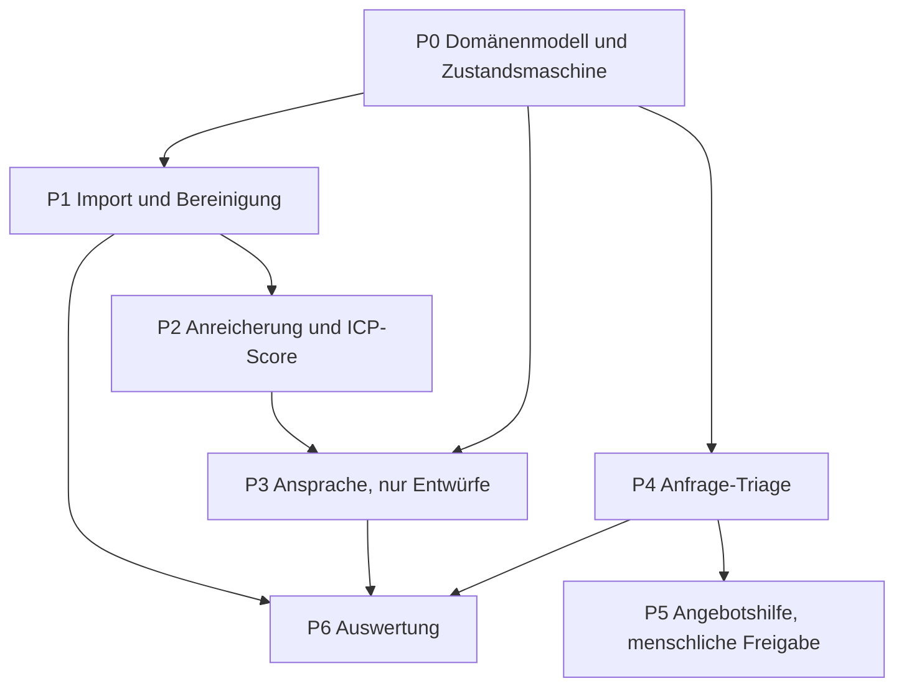

[简体中文](README.md) | [繁體中文](README.zh-Hant.md) | [English](README.en.md) | Deutsch | [Français](README.fr.md) | [Español](README.es.md) | [العربية](README.ar.md)

# Außenhandels-Akquise

Dieses Repository ist ein System für die Außenhandels-Akquise: Regeln, stufenweise Prompts und ein lauffähiger Weg für Import, Bewertung, Entwürfe zur Prüfung und Auswertung. Entwürfe landen in `outbox/` mit `status=pending_review`. Im Code gibt es keinen SMTP-, WhatsApp- oder LinkedIn-Versand.

Anfrage-Triage (P4) und Angebotsunterstützung (P5) sind nicht umgesetzt. Ohne echte Anfragen und Angebote würden diese Schritte nur Regeln erfinden.

## Bestätigte Geschäftsregeln

- `fx_rate` bedeutet, **wie viele Renminbi eine Einheit der Angebotswährung kostet**. Ein Angebot in CNY muss den Kurs 1 verwenden.
- Eine Anfrage mit vollständigen fünf Angaben muss vor dem Angebot trotzdem durch `NEEDS_INFO`.
- `NOT_INTERESTED` und `NURTURE` setzen eine Antwort voraus und sind nur aus `REPLIED` erreichbar.
- Mitarbeiterzahl: `UNKNOWN`, `1-10`, `11-50`, `51-200`, `201-500`, `501-1000`, `1001-5000`, `5001-10000`, `10001+`.
- Jahresumsatz in Renminbi: `UNKNOWN`, `UNDER_1M_CNY` (unter 1 Mio. CNY), `1M_10M_CNY` (1–10 Mio.), `10M_50M_CNY` (10–50 Mio.), `50M_200M_CNY` (50–200 Mio.), `200M_1B_CNY` (200 Mio.–1 Mrd.), `OVER_1B_CNY` (über 1 Mrd.).
- Ergebnis eines Kontakts: `NO_REPLY`, `REPLIED`, `POSITIVE`, `OBJECTION`, `MEETING_SET`, `NOT_INTERESTED`, `NURTURE`, `BOUNCED`, `UNSUBSCRIBED`, `WRONG_CONTACT`.
- Bei CIF und DDP steht die Versicherung in einer eigenen Zeile `insurance`. Der Betrag muss größer als 0 sein und der Prämie aus Rechnungssumme × 110 % × Prämiensatz entsprechen. Die 110 % sind bestätigt. Der Satz steht in `config/quotation.yaml` und ist noch ein Beispielwert.
- Die Sanktionsprüfung vergleicht den Namen exakt und nur, wenn OFAC SDN, die EU-Konsolidierte Liste, die BIS Entity List und UK OFSI zusammen importiert sind. Fehlt eine Liste, wird gesperrt. Ein Treffer darf nicht manuell freigegeben werden.
- Die Dringlichkeit einer Anfrage ist `LOW`, `NORMAL` oder `HIGH`.
- Die Gewichte sind Passung 30, Fenster 20, Wechselhürde 15, Rolle 15, Größe 10, Erreichbarkeit 10. Die Mindestmenge ist 100 pcs, die Lieferzeit 30 days. Diese Werte sind als übliche Vorgabe bestätigt. Monatskapazität, Folgeabstände und Fehlerkosten bleiben Beispiele, bis das Geschäft sie gesondert bestätigt.

## 0. Paket benutzen

1. `.cursor/` liegt im Repository-Wurzelverzeichnis.
2. In den Cursor-Rules müssen `000-global`, `100-trade-domain` und `200-compliance-gate` geladen sein.
3. Es wird jeweils nur ein Prompt gegeben, in der Reihenfolge des Graphen.
4. Nach jedem Prompt werden die Selbsttest-Befehle aus der Ausgabe erneut ausgeführt.

Fehlt eine Voraussetzungsdatei, wird angehalten. Es wird kein Ersatz erfunden.

## 1. Abhängigkeiten



P3 hängt am `icp_score` aus P2. Ansprache vor P2 ergibt nur eine allgemeine Vorlage. P5 erzeugt, sobald es existiert, einen Entwurf zur Prüfung und kein versendetes Angebot.

## 2. Kürzester Weg

| Schritt | Datei | Ergebnis |
|---|---|---|
| 1 | `prompts/P0-data-model.md` | Entitäten, Zustandsmaschine, Migrationen |
| 2 | `prompts/P1-lead-sourcing.md` | Import, Deduplizierung, Sperrliste |
| 3 | `prompts/P2-enrichment-scoring.md` | Anreicherung und Score 0–100 |
| 4 | `prompts/P3-outreach.md` | Entwürfe zur Prüfung |
| 5 | `prompts/P6-eval.md` | Regression und Monatsbericht |

P0, P1, P2, P3 und P6 sind umgesetzt. P4 und P5 warten auf eine brauchbare Menge echter Anfragen.

## 3. Aufbau

```
.cursor/rules/     Vertrag, Handelsklauseln, Compliance-Schranke
prompts/           P0 bis P6
src/               Modelle, Import, Score, Entwürfe, Auswertung, CLI
config/            Gewichte und Produktfakten
eval/              synthetisches Golden Set und Fehlerkosten
alembic/           Datenbankmigrationen
tests/             einschließlich Gegenbeispiele
```

## 4. Abnahme

- `python -m pytest -q` ist grün und enthält Gegenbeispiele.
- `python -m mypy --strict src/` meldet keine Fehler.
- Oberfläche und Fehlermeldungen sind vereinfachtes Chinesisch. Bezeichner sind Englisch. E-Mails an ausländische Käufer nutzen deren Sprache.
- Auf dem Hauptpfad gibt es kein `TODO`, kein leeres `except` und kein `NotImplementedError`.
- Beträge, Mindestmenge, Lieferzeit und Zertifikate stehen nicht fest im Geschäftscode.

## 5. Lokal starten

Python 3.11 oder neuer.

```bash
python -m venv foreign-trade-agent
foreign-trade-agent\Scripts\python.exe -m pip install -e ".[dev]"
foreign-trade-agent\Scripts\python.exe -m pytest -q
foreign-trade-agent\Scripts\python.exe -m mypy --strict src/
foreign-trade-agent\Scripts\python.exe -m alembic upgrade head
```

`DATABASE_URL` ist standardmäßig `sqlite:///./var/dev.db`. Zur Laufzeit wird `config/example.yaml` nicht gelesen.

```bash
python -m src.cli ingest --source customs_csv --file tests/fixtures/customs_sample.csv --dry-run
python -m src.cli queue --owner sales01 --date 2026-10-27 --format table
python -m src.cli draft --queue daily --owner sales01 --dry-run
python -m src.cli eval run --suite eval/golden_set/ --report reports/eval_2026-10-27.json
python -m src.cli report monthly --month 2026-10
python -m src.cli gate check --lead-id <lead-id>
```

`gate check` schreibt nur die Sperre oder die Freigabe in das Audit und sendet nichts. In der mitgelieferten Konfiguration ist die Authentifizierung nicht fertig und keine der vier Sanktionslisten geladen, daher ist das Ergebnis eine Sperre.

Bei zu kleiner Stichprobe sagt der Bericht, dass die Daten nicht reichen und kein Urteil möglich ist. Eine Steigerungsquote wird nicht ausgegeben.
