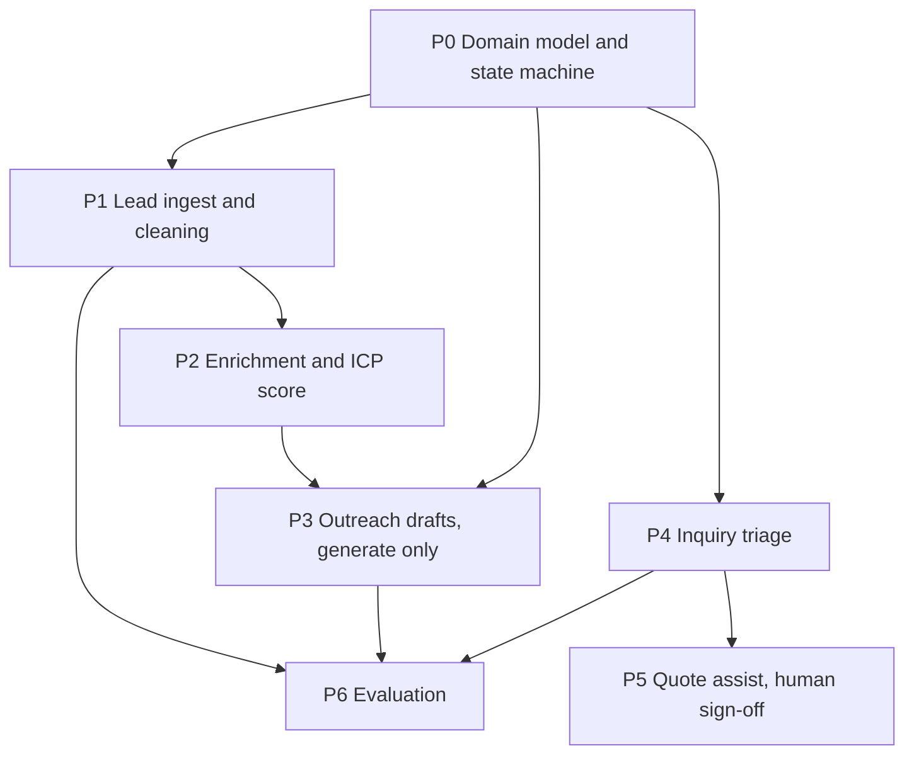

[简体中文](README.md) | [繁體中文](README.zh-Hant.md) | English | [Deutsch](README.de.md) | [Français](README.fr.md) | [Español](README.es.md) | [العربية](README.ar.md)

# Foreign-trade lead generation

This repository is a foreign-trade lead system: constraints, staged prompts, and a working path for ingest, scoring, review-only outreach drafts, and evaluation. Drafts are written to `outbox/` with `status=pending_review`. There is no SMTP, WhatsApp, or LinkedIn send call in the code.

Inquiry triage (P4) and quote assistance (P5) are not implemented. Without real inquiries and quotes, those steps would only invent rules.

## Confirmed business rules

- `fx_rate` means **how many renminbi one unit of the quote currency buys**. A CNY quote must use a rate of 1.
- An inquiry whose five elements are already complete must still pass through `NEEDS_INFO` before a quotation.
- `NOT_INTERESTED` and `NURTURE` require a reply first. They can be entered only from `REPLIED`.
- Headcount bands: `UNKNOWN`, `1-10`, `11-50`, `51-200`, `201-500`, `501-1000`, `1001-5000`, `5001-10000`, `10001+`.
- Annual revenue bands, in US dollars: `UNKNOWN`, `UNDER_1M`, `1M_10M`, `10M_50M`, `50M_200M`, `200M_1B`, `OVER_1B`.
- Follow-up outcomes: `NO_REPLY`, `REPLIED`, `POSITIVE`, `OBJECTION`, `MEETING_SET`, `NOT_INTERESTED`, `NURTURE`, `BOUNCED`, `UNSUBSCRIBED`, `WRONG_CONTACT`.
- CIF and DDP insurance must be its own `insurance` line, and the amount must be greater than 0.
- Inquiry urgency is `LOW`, `NORMAL`, or `HIGH`.
- Score weights are demand fit 30, window 20, switchability 15, role 15, scale 10, reachability 10. MOQ is 100 pcs and lead time is 30 days. Those figures are the confirmed convention. Monthly capacity, sequence spacing, and misclassification costs remain examples pending a separate business confirmation.

## 0. How to use the kit

1. `.cursor/` must sit at the repository root.
2. In Cursor Rules, confirm that `000-global`, `100-trade-domain`, and `200-compliance-gate` are loaded.
3. Feed one prompt at a time, in the order of the graph below.
4. After each prompt, rerun the self-test commands from its output.

If a prerequisite file is missing, stop. Do not invent a stand-in.

## 1. Dependency graph



P3 depends on P2's `icp_score`. Writing outreach before P2 produces a generic letter. P5, when it exists, produces a draft for review, never a quote sent to the buyer.

## 2. Minimum path

| Step | File | Result |
|---|---|---|
| 1 | `prompts/P0-data-model.md` | Entities, state machine, migrations |
| 2 | `prompts/P1-lead-sourcing.md` | Ingest, dedupe, suppression |
| 3 | `prompts/P2-enrichment-scoring.md` | Enrichment and a 0–100 score |
| 4 | `prompts/P3-outreach.md` | Drafts waiting for review |
| 5 | `prompts/P6-eval.md` | Regression and the monthly report |

P0, P1, P2, P3, and P6 are implemented. P4 and P5 wait until there is a usable set of real inquiries.

## 3. Layout

```
.cursor/rules/     global contract, trade terms, compliance gate
prompts/           P0 through P6
src/               models, ingest, scoring, drafts, evaluation, CLI
config/            score weights and product facts
eval/              synthetic golden set and misclassification costs
alembic/           database migrations
tests/             including counterexamples
```

## 4. Acceptance

- `python -m pytest -q` is green and includes counterexamples.
- `python -m mypy --strict src/` reports no errors.
- UI and error text are Simplified Chinese. Identifiers are English. Email bodies to overseas buyers use the buyer's language.
- The main path has no `TODO`, empty `except`, or `NotImplementedError`.
- Amounts, MOQ, lead time, and certifications are not hardcoded in business code.

## 5. Run locally

Python 3.11 or newer is required.

```bash
python -m venv foreign-trade-agent
foreign-trade-agent\Scripts\python.exe -m pip install -e ".[dev]"
foreign-trade-agent\Scripts\python.exe -m pytest -q
foreign-trade-agent\Scripts\python.exe -m mypy --strict src/
foreign-trade-agent\Scripts\python.exe -m alembic upgrade head
```

`DATABASE_URL` defaults to `sqlite:///./var/dev.db`. Runtime code does not read `config/example.yaml`.

```bash
python -m src.cli ingest --source customs_csv --file tests/fixtures/customs_sample.csv --dry-run
python -m src.cli queue --owner sales01 --date 2026-10-27 --format table
python -m src.cli draft --queue daily --owner sales01 --dry-run
python -m src.cli eval run --suite eval/golden_set/ --report reports/eval_2026-10-27.json
python -m src.cli report monthly --month 2026-10
python -m src.cli gate check --lead-id <lead-id>
```

`gate check` records a block or an allow and does not send. With the shipped config, authentication is not ready and the sanctions list is not loaded, so the result is a block.

When the sample is too small, the report says the data is insufficient and that no conclusion can be drawn. It does not print a lift percentage.
