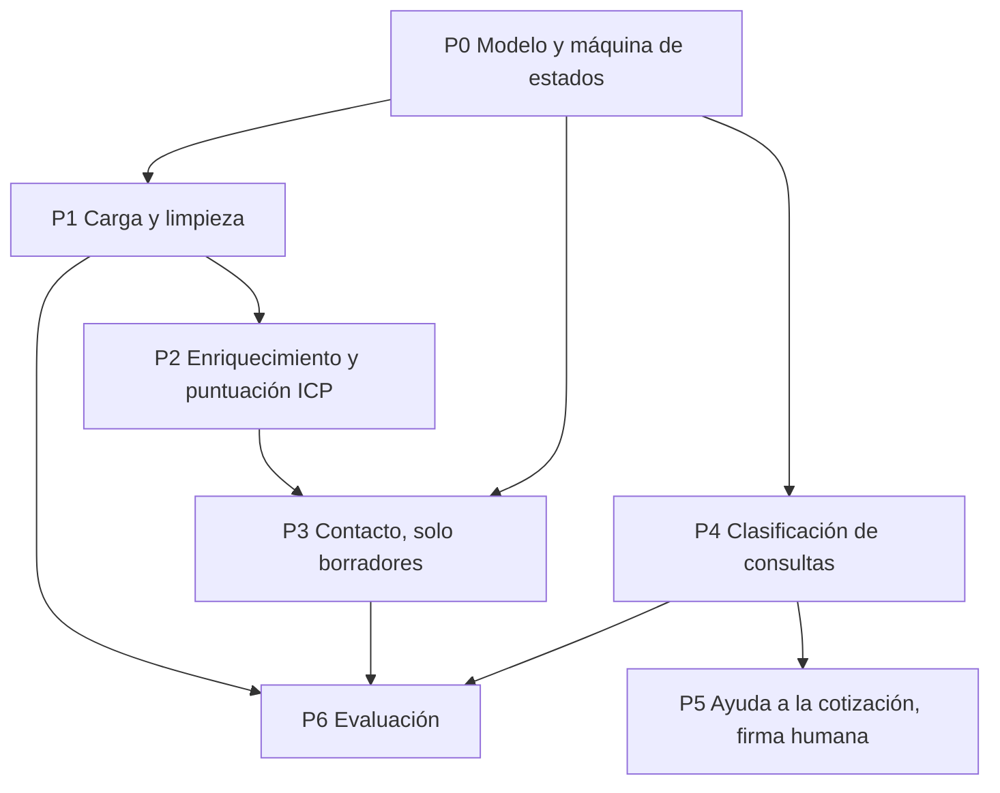

[简体中文](README.md) | [繁體中文](README.zh-Hant.md) | [English](README.en.md) | [Deutsch](README.de.md) | [Français](README.fr.md) | Español | [العربية](README.ar.md)

# Captación para comercio exterior

Este repositorio es un sistema de captación para comercio exterior: restricciones, prompts por etapas y un camino ya operativo de carga, puntuación, borradores pendientes de revisión y evaluación. Los borradores se escriben en `outbox/` con `status=pending_review`. El código no envía por SMTP, WhatsApp ni LinkedIn.

La clasificación de consultas (P4) y la ayuda a la cotización (P5) no están hechas. Sin consultas y cotizaciones reales, esos pasos solo inventarían reglas.

## Reglas de negocio confirmadas

- `fx_rate` indica **cuántos renminbi vale una unidad de la moneda de la cotización**. Una cotización en CNY usa un tipo de 1.
- Una consulta con los cinco datos ya completos debe pasar igualmente por `NEEDS_INFO` antes de cotizar.
- `NOT_INTERESTED` y `NURTURE` exigen una respuesta previa y solo se entran desde `REPLIED`.
- Plantilla de empleados: `UNKNOWN`, `1-10`, `11-50`, `51-200`, `201-500`, `501-1000`, `1001-5000`, `5001-10000`, `10001+`.
- Facturación anual en dólares: `UNKNOWN`, `UNDER_1M`, `1M_10M`, `10M_50M`, `50M_200M`, `200M_1B`, `OVER_1B`.
- Resultado del seguimiento: `NO_REPLY`, `REPLIED`, `POSITIVE`, `OBJECTION`, `MEETING_SET`, `NOT_INTERESTED`, `NURTURE`, `BOUNCED`, `UNSUBSCRIBED`, `WRONG_CONTACT`.
- En CIF y DDP el seguro va en una línea propia `insurance`, y el importe tiene que ser mayor que 0.
- La urgencia de la consulta es `LOW`, `NORMAL` o `HIGH`.
- Los pesos son encaje 30, ventana 20, dificultad de cambio 15, rol 15, escala 10, alcanzabilidad 10. El pedido mínimo es 100 pcs y el plazo 30 days. Esas cifras quedan confirmadas como la convención. La capacidad mensual, el espaciado de seguimientos y el coste de los errores de clasificación siguen siendo ejemplos pendientes de otra confirmación.

## 0. Cómo usar el paquete

1. `.cursor/` está en la raíz del repositorio.
2. En las Rules de Cursor están cargadas `000-global`, `100-trade-domain` y `200-compliance-gate`.
3. Se entrega un solo prompt cada vez, en el orden del grafo.
4. Después de cada prompt se vuelven a ejecutar los comandos de autocomprobación que aparecen en la salida.

Si falta un archivo previo, se detiene el trabajo. No se inventa un sustituto.

## 1. Dependencias



P3 depende de `icp_score` de P2. Escribir el contacto antes de P2 produce una plantilla genérica. P5, cuando exista, producirá un borrador para revisión, nunca una cotización enviada.

## 2. Camino mínimo

| Paso | Archivo | Resultado |
|---|---|---|
| 1 | `prompts/P0-data-model.md` | Entidades, máquina de estados, migraciones |
| 2 | `prompts/P1-lead-sourcing.md` | Carga, deduplicación, lista de supresión |
| 3 | `prompts/P2-enrichment-scoring.md` | Enriquecimiento y puntuación de 0 a 100 |
| 4 | `prompts/P3-outreach.md` | Borradores pendientes de revisión |
| 5 | `prompts/P6-eval.md` | Regresión e informe mensual |

P0, P1, P2, P3 y P6 ya están implementados. P4 y P5 esperan un volumen útil de consultas reales.

## 3. Estructura

```
.cursor/rules/     contrato, incoterms, compuerta de cumplimiento
prompts/           P0 a P6
src/               modelos, carga, puntuación, borradores, evaluación, CLI
config/            pesos y hechos de producto
eval/              conjunto dorado sintético y coste de los errores
alembic/           migraciones
tests/             incluidos los contraejemplos
```

## 4. Aceptación

- `python -m pytest -q` está en verde e incluye contraejemplos.
- `python -m mypy --strict src/` no informa errores.
- La interfaz y los errores están en chino simplificado. Los identificadores están en inglés. El cuerpo del correo a un comprador extranjero usa su idioma.
- La ruta principal no deja `TODO`, `except` vacío ni `NotImplementedError`.
- Importes, pedido mínimo, plazo y certificaciones no van fijos en el código de negocio.

## 5. Ejecución local

Hace falta Python 3.11 o posterior.

```bash
python -m venv foreign-trade-agent
foreign-trade-agent\Scripts\python.exe -m pip install -e ".[dev]"
foreign-trade-agent\Scripts\python.exe -m pytest -q
foreign-trade-agent\Scripts\python.exe -m mypy --strict src/
foreign-trade-agent\Scripts\python.exe -m alembic upgrade head
```

`DATABASE_URL` vale por defecto `sqlite:///./var/dev.db`. En ejecución no se lee `config/example.yaml`.

```bash
python -m src.cli ingest --source customs_csv --file tests/fixtures/customs_sample.csv --dry-run
python -m src.cli queue --owner sales01 --date 2026-10-27 --format table
python -m src.cli draft --queue daily --owner sales01 --dry-run
python -m src.cli eval run --suite eval/golden_set/ --report reports/eval_2026-10-27.json
python -m src.cli report monthly --month 2026-10
```

Si la muestra es pequeña, el informe dice que los datos no bastan y que no se puede concluir. No escribe un porcentaje de mejora.
