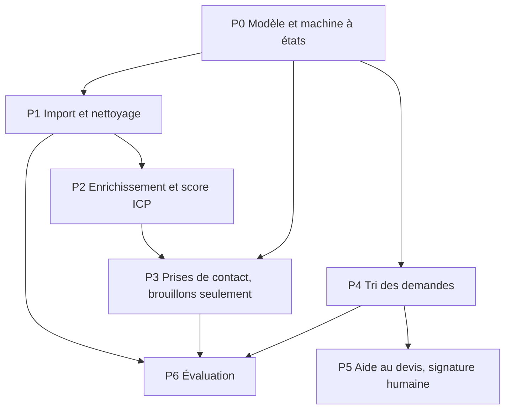

[简体中文](README.md) | [繁體中文](README.zh-Hant.md) | [English](README.en.md) | [Deutsch](README.de.md) | Français | [Español](README.es.md) | [العربية](README.ar.md)

# Prospection pour le commerce extérieur

Ce dépôt est un système de prospection pour le commerce extérieur : contraintes, invites par étape, et un chemin déjà en place pour l'import, le score, les brouillons à relire et l'évaluation. Les brouillons vont dans `outbox/` avec `status=pending_review`. Le code n'appelle ni SMTP, ni WhatsApp, ni LinkedIn pour envoyer.

Le tri des demandes (P4) et l'aide au devis (P5) ne sont pas réalisés. Sans vraies demandes ni vrais devis, ces étapes ne feraient qu'inventer des règles.

## Règles métier confirmées

- `fx_rate` indique **combien de renminbi vaut une unité de la devise du devis**. Un devis en CNY utilise un taux de 1.
- Une demande dont les cinq éléments sont déjà complets doit quand même passer par `NEEDS_INFO` avant le devis.
- `NOT_INTERESTED` et `NURTURE` exigent une réponse préalable et ne partent que de `REPLIED`.
- Effectif : `UNKNOWN`, `1-10`, `11-50`, `51-200`, `201-500`, `501-1000`, `1001-5000`, `5001-10000`, `10001+`.
- Chiffre d'affaires annuel en dollars : `UNKNOWN`, `UNDER_1M`, `1M_10M`, `10M_50M`, `50M_200M`, `200M_1B`, `OVER_1B`.
- Résultat d'un échange : `NO_REPLY`, `REPLIED`, `POSITIVE`, `OBJECTION`, `MEETING_SET`, `NOT_INTERESTED`, `NURTURE`, `BOUNCED`, `UNSUBSCRIBED`, `WRONG_CONTACT`.
- Pour CIF et DDP, l'assurance est une ligne `insurance` à part, et le montant doit être supérieur à 0.
- L'urgence d'une demande est `LOW`, `NORMAL` ou `HIGH`.
- Les poids sont adéquation 30, fenêtre 20, difficulté de bascule 15, rôle 15, taille 10, joignabilité 10. Le minimum de commande est 100 pcs et le délai 30 days. Ces chiffres sont la convention confirmée. La capacité mensuelle, l'espacement des relances et le coût des erreurs de classement restent des exemples en attente d'une confirmation séparée.

## 0. Utiliser le kit

1. `.cursor/` est à la racine du dépôt.
2. Dans les Rules de Cursor, `000-global`, `100-trade-domain` et `200-compliance-gate` sont chargées.
3. On donne une seule invite à la fois, dans l'ordre du graphe.
4. Après chaque invite, on relance les commandes d'autotest indiquées dans la sortie.

S'il manque un fichier préalable, on s'arrête. On n'invente pas de remplacement.

## 1. Dépendances



P3 dépend de `icp_score` produit par P2. Écrire avant P2 ne donne qu'un modèle générique. P5, le jour où il existera, produira un brouillon à relire, jamais un devis envoyé.

## 2. Chemin minimal

| Étape | Fichier | Résultat |
|---|---|---|
| 1 | `prompts/P0-data-model.md` | Entités, machine à états, migrations |
| 2 | `prompts/P1-lead-sourcing.md` | Import, dédoublonnage, liste de suppression |
| 3 | `prompts/P2-enrichment-scoring.md` | Enrichissement et score de 0 à 100 |
| 4 | `prompts/P3-outreach.md` | Brouillons à relire |
| 5 | `prompts/P6-eval.md` | Régression et rapport mensuel |

P0, P1, P2, P3 et P6 sont en place. P4 et P5 attendent un volume utilisable de vraies demandes.

## 3. Arborescence

```
.cursor/rules/     contrat, incoterms, porte de conformité
prompts/           P0 à P6
src/               modèles, import, score, brouillons, évaluation, CLI
config/            poids et faits produit
eval/              jeu d'or synthétique et coût des erreurs
alembic/           migrations
tests/             y compris les contre-exemples
```

## 4. Recette

- `python -m pytest -q` est vert et contient des contre-exemples.
- `python -m mypy --strict src/` ne signale aucune erreur.
- L'interface et les erreurs sont en chinois simplifié. Les identifiants sont en anglais. Le corps d'un e-mail vers un acheteur étranger utilise sa langue.
- Le chemin principal ne contient ni `TODO`, ni `except` vide, ni `NotImplementedError`.
- Les montants, le minimum de commande, le délai et les certifications ne sont pas codés en dur dans le métier.

## 5. Lancer en local

Python 3.11 ou plus récent.

```bash
python -m venv foreign-trade-agent
foreign-trade-agent\Scripts\python.exe -m pip install -e ".[dev]"
foreign-trade-agent\Scripts\python.exe -m pytest -q
foreign-trade-agent\Scripts\python.exe -m mypy --strict src/
foreign-trade-agent\Scripts\python.exe -m alembic upgrade head
```

`DATABASE_URL` vaut par défaut `sqlite:///./var/dev.db`. Le code d'exécution ne lit pas `config/example.yaml`.

```bash
python -m src.cli ingest --source customs_csv --file tests/fixtures/customs_sample.csv --dry-run
python -m src.cli queue --owner sales01 --date 2026-10-27 --format table
python -m src.cli draft --queue daily --owner sales01 --dry-run
python -m src.cli eval run --suite eval/golden_set/ --report reports/eval_2026-10-27.json
python -m src.cli report monthly --month 2026-10
python -m src.cli gate check --lead-id <lead-id>
```

`gate check` n'enregistre qu'un blocage ou un feu vert et n'envoie rien. Dans la configuration livrée, l'authentification n'est pas prête et la liste de sanctions n'est pas chargée, donc le résultat est un blocage.

Si l'échantillon est trop petit, le rapport dit que les données sont insuffisantes et qu'aucune conclusion n'est possible. Il n'affiche pas de pourcentage de gain.
