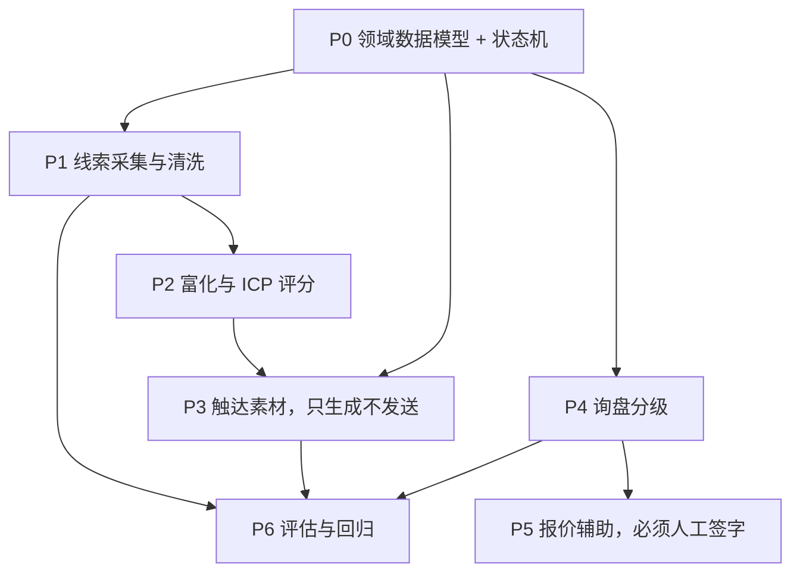

简体中文 | [繁體中文](README.zh-Hant.md) | [English](README.en.md) | [Deutsch](README.de.md) | [Français](README.fr.md) | [Español](README.es.md) | [العربية](README.ar.md)

# 外贸前端获客

这个仓库是一套外贸获客系统：约束、分阶段提示词，以及已经落地的入库、评分、待审开发信和评估。开发信只写入 `outbox/`，状态为 `pending_review`。代码里没有 SMTP、WhatsApp 或 LinkedIn 发送。

询盘分级（P4）和报价辅助（P5）还没有做。没有真实询盘和报价样本时，那两步只会编出规则。

## 已确认的业务口径

- `fx_rate` 表示 **1 单位报价币种兑多少人民币**。报价币种是人民币时，汇率必须是 1。
- 五要素已经齐全的询盘，仍然必须经过 `NEEDS_INFO`，才能进入报价。
- `NOT_INTERESTED` 和 `NURTURE` 必须先有回复，只能从 `REPLIED` 进入。
- 员工人数用 `UNKNOWN`、`1-10`、`11-50`、`51-200`、`201-500`、`501-1000`、`1001-5000`、`5001-10000`、`10001+`。
- 年营收用人民币分档：`UNKNOWN`（未知）、`UNDER_1M_CNY`（100万以下）、`1M_10M_CNY`（100万至1000万）、`10M_50M_CNY`（1000万至5000万）、`50M_200M_CNY`（5000万至2亿）、`200M_1B_CNY`（2亿至10亿）、`OVER_1B_CNY`（10亿以上）。
- 跟进结果用 `NO_REPLY`、`REPLIED`、`POSITIVE`、`OBJECTION`、`MEETING_SET`、`NOT_INTERESTED`、`NURTURE`、`BOUNCED`、`UNSUBSCRIBED`、`WRONG_CONTACT`。
- CIF 和 DDP 的保险必须单独写在 `insurance`，金额大于 0，并且等于发票金额 × 110% × 保险费率。110% 已确认。费率在 `config/quotation.yaml`，仍是示例。
- 制裁筛查四份名单一起做精确匹配：OFAC SDN、欧盟综合清单、BIS Entity List、UK OFSI。未全部导入就拦截，命中后不能人工放行。
- 询盘紧急度就是 `LOW`、`NORMAL`、`HIGH`。
- 评分权重为需求匹配 30、窗口 20、切换难度 15、角色 15、规模 10、可达性 10。起订量 100 pcs，交期 30 days。这组数已按惯例确认。月产能、跟进间隔和错分代价仍是待业务另行确认的示例。

## 0. 怎么用这个包

1. 仓库根目录要有 `.cursor/`。
2. 在 Cursor 的 Rules 里确认 `000-global`、`100-trade-domain`、`200-compliance-gate` 已被识别。
3. 按下面的依赖图，一次只喂一条 prompt。
4. 每条 prompt 跑完，先看输出里的自测命令，自己再跑一遍。

缺前置文件就停下，不要自己编一份看起来对的前置。

## 1. 依赖图



P3 依赖 P2 的 `icp_score`。P2 没做完就写开发信，只能得到通用模板。P5 的产出永远是待审草稿，不是对外报价。

## 2. 最小可用路径

| 步骤 | 文件 | 产出 |
|---|---|---|
| 1 | `prompts/P0-data-model.md` | 实体、状态机、迁移 |
| 2 | `prompts/P1-lead-sourcing.md` | 入库、去重、抑制名单 |
| 3 | `prompts/P2-enrichment-scoring.md` | 富化与 0–100 评分 |
| 4 | `prompts/P3-outreach.md` | 待审开发信 |
| 5 | `prompts/P6-eval.md` | 回归与月报 |

P0、P1、P2、P3、P6 已有实现。P4 和 P5 等真实询盘达到可用样本量再做。

## 3. 目录

```
.cursor/rules/     全局契约、贸易术语、合规闸门
prompts/           P0 到 P6
src/               模型、入库、评分、开发信、评估、命令行
config/            评分权重与产品事实
eval/              合成黄金集与错分代价
alembic/           数据库迁移
tests/             含反例
```

## 4. 验收

- `python -m pytest -q` 全绿，并且有反例。
- `python -m mypy --strict src/` 无错误。
- 界面和错误提示用简体中文。代码标识符用英文。给海外买家的邮件正文用对方语言。
- 主路径不留 `TODO`、空的 `except` 或 `NotImplementedError`。
- 金额、起订量、交期、认证不写死在业务代码里。

## 5. 本地运行

需要 Python 3.11 或更高版本。

```bash
python -m venv foreign-trade-agent
foreign-trade-agent\Scripts\python.exe -m pip install -e ".[dev]"
foreign-trade-agent\Scripts\python.exe -m pytest -q
foreign-trade-agent\Scripts\python.exe -m mypy --strict src/
foreign-trade-agent\Scripts\python.exe -m alembic upgrade head
```

`DATABASE_URL` 缺省是 `sqlite:///./var/dev.db`。运行时不读 `config/example.yaml`。

```bash
python -m src.cli ingest --source customs_csv --file tests/fixtures/customs_sample.csv --dry-run
python -m src.cli queue --owner sales01 --date 2026-10-27 --format table
python -m src.cli draft --queue daily --owner sales01 --dry-run
python -m src.cli eval run --suite eval/golden_set/ --report reports/eval_2026-10-27.json
python -m src.cli report monthly --month 2026-10
python -m src.cli gate check --lead-id <线索号>
```

`gate check` 只做拦截和审计，不发送。默认认证未就绪，四份制裁名单都未导入，所以结果是拦截。

评估样本不足时，报告写「数据不足」和「暂不能判断」，不写提升百分比。
