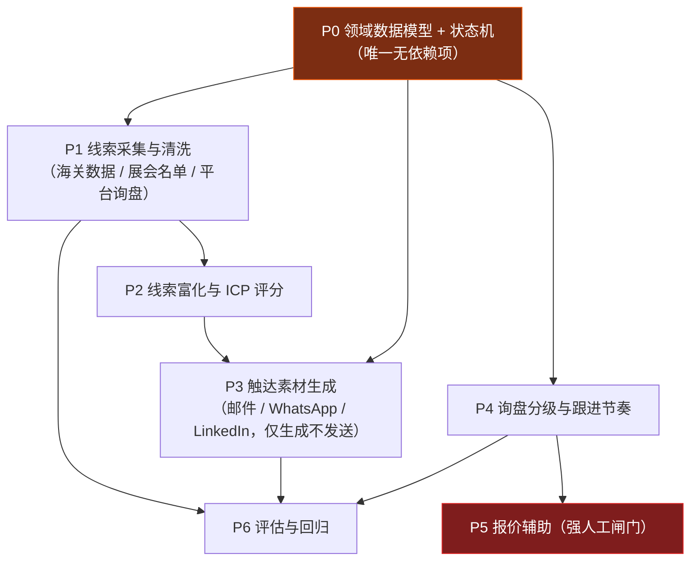

# 外贸前端获客 AI Agent — Cursor 工程包

面向对象：产品经理 / 技术负责人，要在 Cursor 里从零搭一套「外贸前端获客」AI agent。
本包不提供业务代码，提供 **约束层（rules）+ 分阶段提示词（prompts）+ 验收标准**。

---

## 0. 怎么用这个包

1. 把 `cursor-agent-kit/` 里的 **全部内容** 复制到你 Cursor 项目的**根目录**（`.cursor/` 必须在项目根）。
2. 打开 Cursor → Settings → Rules，确认 `000-global`、`100-trade-domain`、`200-compliance-gate` 三条规则被识别。
3. 按 `依赖图` 的顺序，**一次只喂一条 prompt**。每条 prompt 都是自包含的，不要跳步。
4. 每条 prompt 跑完，先看它输出的第 2 段「自测命令与真实输出」，自己复跑一遍。跑不通就不要进下一步。

> 硬规则：**缺前置文件就停下，不要自己造**。AI 自己编一份"看起来对"的前置，会让后面全线崩。

---

## 1. 依赖图（执行顺序 ≠ 文件编号顺序）



**容易踩的坑**：P3（触达）看起来排在第三位就该第三个做，但它依赖 P2 的 `icp_score` 和 `pain_hypothesis` 字段。如果 P2 没跑完就做 P3，生成出来的开发信只能写通用模板，等于白做。

**红色 = 必须有人签字的环节**。P5 报价辅助产出的是「待审草稿」，永远不是「对外报价」。

---

## 2. 最小可用路径（别一次做全套）

外贸公司的现实是：业务员不缺口号，缺的是「今天该联系谁、说什么」。所以先做**单点闭环**，不要先做平台。

| 步骤 | 文件 | 产出 | 这一步能验证什么 |
|---|---|---|---|
| 1 | `prompts/P0-data-model.md` | 实体定义 + 状态机 + 迁移脚本 | 业务语义是否对齐 |
| 2 | `prompts/P1-lead-sourcing.md` | 线索入库 + 去重 + 抑制名单 | 数据源能不能进得来 |
| 3 | `prompts/P2-enrichment-scoring.md` | 富化字段 + 0-100 评分 | 排序是否比人工靠谱 |
| 4 | `prompts/P3-outreach.md` | 开发信草稿（进 outbox，不发） | 业务员愿不愿意直接用 |
| 5 | `prompts/P6-eval.md` | 基线指标 + 回归集 | 有没有变好，怎么证明 |

跑完这 5 步就有 MVP。P4/P5（询盘与报价）建议在拿到 200+ 条真实外呼结果之后再上——没有真实回复数据，询盘分级规则只能拍脑袋。

---

## 3. 目录结构

```
.cursor/rules/
  000-global.mdc            全局输出契约、禁止事项、技术栈
  100-trade-domain.mdc      外贸领域模型与术语准确性（防"业务上错但代码能跑"）
  200-compliance-gate.mdc   合规闸门（fail-closed）
prompts/
  P0-data-model.md
  P1-lead-sourcing.md
  P2-enrichment-scoring.md
  P3-outreach.md
  P4-inquiry-triage.md
  P5-quote-assist.md
  P6-eval.md
```

---

## 4. 全局验收标准（任何一步都适用）

跑完任意一条 prompt，仓库必须同时满足：

- `python -m pytest -q` 全绿，且测试里有**至少一条反例**（非法输入必须被拒，不是被吞）
- `python -m mypy --strict src/` 无 error
- 所有对外可见字符串为简体中文（代码标识符、字段名除外）
- 没有任何 `TODO` / `pass  # 后续补` / `NotImplementedError` 留在主路径
- 所有金额、MOQ、交期、认证结论均**来自配置文件或人工输入表**，代码里搜不到硬编码数值

**不做完这些，不要进下一个 prompt。**

---

## 5. P0 本地运行

环境名 `foreign-trade-agent`。解释器使用本机 Python 3.11。

```bash
C:\Users\94765\AppData\Local\Programs\Python\Python311\python.exe -m venv foreign-trade-agent
foreign-trade-agent\Scripts\python.exe -m pip install -e ".[dev]"
foreign-trade-agent\Scripts\python.exe -m pytest tests/models/ -v
foreign-trade-agent\Scripts\python.exe -m mypy --strict src/models/
foreign-trade-agent\Scripts\python.exe -m alembic upgrade head
```

`DATABASE_URL` 缺省为 `sqlite:///./var/dev.db`，可用环境变量覆盖。运行时不读取 `config/example.yaml`。本阶段没有外部凭证；缺种子文件 `seeds/reference.yaml` 时 `load_reference_seed()` 抛 `ConfigError`。

## 6. 获客闭环命令

P4 询盘分级和 P5 报价辅助没有实现：没有真实询盘和报价样本，这两步只会编造规则。当前命令覆盖入库、评分队列、待审开发信和评估。

```bash
foreign-trade-agent\Scripts\python.exe -m src.cli ingest --source customs_csv --file tests/fixtures/customs_sample.csv --dry-run
foreign-trade-agent\Scripts\python.exe -m src.cli queue --owner sales01 --date 2026-10-27 --format table
foreign-trade-agent\Scripts\python.exe -m src.cli draft --queue daily --owner sales01 --dry-run
foreign-trade-agent\Scripts\python.exe -m src.cli eval run --suite eval/golden_set/ --report reports/eval_2026-10-27.json
foreign-trade-agent\Scripts\python.exe -m src.cli report monthly --month 2026-10
```

`draft` 只把 `status=pending_review` 的 JSON 写到 `outbox/`。代码里没有 SMTP、WhatsApp 或 LinkedIn 发送。评估报告在真实样本不足时写「数据不足」和「暂不能判断」，不写提升百分比。评分权重、起订量、交期和错分代价都在 `config/scoring.yaml`、`config/product.yaml`、`eval/cost_matrix.yaml`，注释标明上线前要由业务确认。
