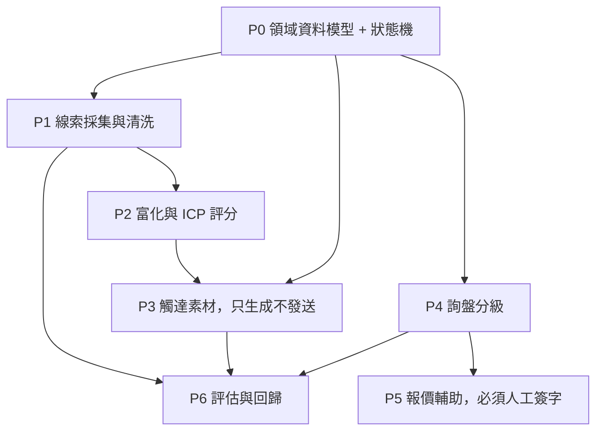

[简体中文](README.md) | 繁體中文 | [English](README.en.md) | [Deutsch](README.de.md) | [Français](README.fr.md) | [Español](README.es.md) | [العربية](README.ar.md)

# 外貿前端獲客

這個倉庫是一套外貿獲客系統：約束、分階段提示詞，以及已經落地的入庫、評分、待審開發信和評估。開發信只寫入 `outbox/`，狀態為 `pending_review`。程式裡沒有 SMTP、WhatsApp 或 LinkedIn 發送。

詢盤分級（P4）和報價輔助（P5）還沒有做。沒有真實詢盤和報價樣本時，那兩步只會編出規則。

## 已確認的業務口徑

- `fx_rate` 表示 **1 單位報價幣種兌多少人民幣**。報價幣種是人民幣時，匯率必須是 1。
- 五要素已經齊全的詢盤，仍然必須經過 `NEEDS_INFO`，才能進入報價。
- `NOT_INTERESTED` 和 `NURTURE` 必須先有回覆，只能從 `REPLIED` 進入。
- 員工人數用 `UNKNOWN`、`1-10`、`11-50`、`51-200`、`201-500`、`501-1000`、`1001-5000`、`5001-10000`、`10001+`。
- 年營收用美元分檔：`UNKNOWN`、`UNDER_1M`、`1M_10M`、`10M_50M`、`50M_200M`、`200M_1B`、`OVER_1B`。
- 跟進結果用 `NO_REPLY`、`REPLIED`、`POSITIVE`、`OBJECTION`、`MEETING_SET`、`NOT_INTERESTED`、`NURTURE`、`BOUNCED`、`UNSUBSCRIBED`、`WRONG_CONTACT`。
- CIF 和 DDP 的保險必須單獨寫在 `insurance`，而且金額大於 0。
- 詢盤緊急度就是 `LOW`、`NORMAL`、`HIGH`。
- 評分權重為需求匹配 30、窗口 20、切換難度 15、角色 15、規模 10、可達性 10。起訂量 100 pcs，交期 30 days。這組數已按慣例確認。月產能、跟進間隔和錯分代價仍是待業務另行確認的示例。

## 0. 怎麼用這個包

1. 倉庫根目錄要有 `.cursor/`。
2. 在 Cursor 的 Rules 裡確認 `000-global`、`100-trade-domain`、`200-compliance-gate` 已被識別。
3. 按下面的依賴圖，一次只餵一條 prompt。
4. 每條 prompt 跑完，先看輸出裡的自測命令，自己再跑一遍。

缺前置檔案就停下，不要自己編一份看起來對的前置。

## 1. 依賴圖



P3 依賴 P2 的 `icp_score`。P2 沒做完就寫開發信，只能得到通用模板。P5 的產出永遠是待審草稿，不是對外報價。

## 2. 最小可用路徑

| 步驟 | 檔案 | 產出 |
|---|---|---|
| 1 | `prompts/P0-data-model.md` | 實體、狀態機、遷移 |
| 2 | `prompts/P1-lead-sourcing.md` | 入庫、去重、抑制名單 |
| 3 | `prompts/P2-enrichment-scoring.md` | 富化與 0–100 評分 |
| 4 | `prompts/P3-outreach.md` | 待審開發信 |
| 5 | `prompts/P6-eval.md` | 回歸與月報 |

P0、P1、P2、P3、P6 已有實現。P4 和 P5 等真實詢盤達到可用樣本量再做。

## 3. 目錄

```
.cursor/rules/     全域契約、貿易術語、合規閘門
prompts/           P0 到 P6
src/               模型、入庫、評分、開發信、評估、命令列
config/            評分權重與產品事實
eval/              合成黃金集與錯分代價
alembic/           資料庫遷移
tests/             含反例
```

## 4. 驗收

- `python -m pytest -q` 全綠，並且有反例。
- `python -m mypy --strict src/` 無錯誤。
- 介面和錯誤提示用簡體中文。程式識別字用英文。給海外買家的郵件正文用對方語言。
- 主路徑不留 `TODO`、空的 `except` 或 `NotImplementedError`。
- 金額、起訂量、交期、認證不寫死在業務程式裡。

## 5. 本機運行

需要 Python 3.11 或更高版本。

```bash
python -m venv foreign-trade-agent
foreign-trade-agent\Scripts\python.exe -m pip install -e ".[dev]"
foreign-trade-agent\Scripts\python.exe -m pytest -q
foreign-trade-agent\Scripts\python.exe -m mypy --strict src/
foreign-trade-agent\Scripts\python.exe -m alembic upgrade head
```

`DATABASE_URL` 預設是 `sqlite:///./var/dev.db`。運行時不讀 `config/example.yaml`。

```bash
python -m src.cli ingest --source customs_csv --file tests/fixtures/customs_sample.csv --dry-run
python -m src.cli queue --owner sales01 --date 2026-10-27 --format table
python -m src.cli draft --queue daily --owner sales01 --dry-run
python -m src.cli eval run --suite eval/golden_set/ --report reports/eval_2026-10-27.json
python -m src.cli report monthly --month 2026-10
python -m src.cli gate check --lead-id <線索號>
```

`gate check` 只做攔截和審計，不發送。預設認證未就緒、制裁名單未匯入，所以結果是攔截。

評估樣本不足時，報告寫「數據不足」和「暫不能判斷」，不寫提升百分比。
